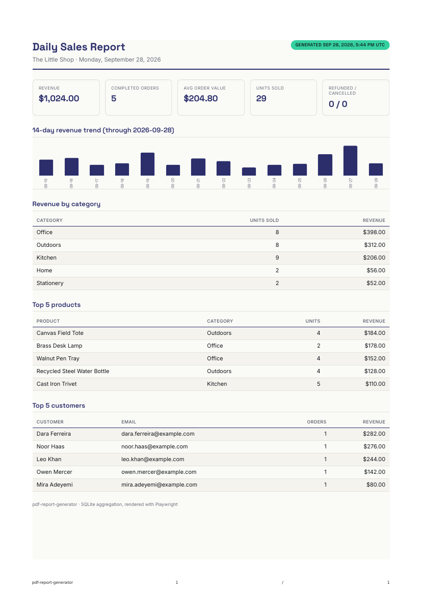

# pdf-report-generator

A daily sales report for a small shop: query the database, aggregate it in
SQL, render it to a PDF, and serve it through a REST API — on demand, with
"ask twice, get one" idempotency.

This is FlyRank Internship Backend Track A8. Lane: **JavaScript**. Dataset:
**the little shop** (seeded fake orders).



## Why this exists

"Generate a report" is the most classic background job in software — every
SaaS ships one. Building it end to end touches four separate skills at
once: SQL aggregation, HTML→PDF rendering, artifact handling (store a file
once, hand back a link — never pass the bytes around), and REST
idempotency. None of those are individually hard; getting all four right
in one feature is the point of the exercise.

## Stack

- **Data**: SQLite via `node:sqlite` — built into Node 22+, nothing to
  install.
- **API**: Express 5.
- **Rendering**: Playwright (headless Chromium) — `page.setContent(html)` +
  `page.pdf()`. Real layout engine, real CSS print support, no hand-rolled
  PDF-drawing API.
- **Fonts**: `@fontsource/inter` + `@fontsource/space-grotesk`, embedded in
  the report as base64 `@font-face` data URIs (see "Setup notes" below).

## Setup

```bash
npm install
npm run seed     # idempotent — safe to re-run any time you want a clean slate
npm start         # listens on :3000 (set PORT to override)
```

`npm run seed` deletes every row in dependency order and re-inserts from a
seeded PRNG, so running it twice in a row leaves exactly one clean copy of
the data — never two, and always the same numbers. The dataset spans the
last 60 days through today, so there's always something to report on the
day you clone this.

### Setup notes (this sandbox specifically)

Two things needed a workaround in the environment this was built in — both
transparent, neither a compromise on the actual assignment:

- **Chromium executable path.** The sandbox ships a pinned Chromium build
  under `PLAYWRIGHT_BROWSERS_PATH` that doesn't always match the revision
  the installed `playwright` npm package expects, so a bare
  `chromium.launch()` looked for a binary that wasn't there. `src/render.js`
  points `executablePath` at the pre-installed build when it exists,
  falling back to Playwright's own resolution otherwise. Outside this
  sandbox, `npx playwright install chromium` once and drop that option.
- **Self-hosted fonts.** `fonts.googleapis.com` isn't reachable from this
  sandbox's network policy, so the brand fonts (Space Grotesk / Inter) are
  installed from npm (`@fontsource/*`) and inlined as base64 `@font-face`
  data URIs in `src/fonts.js` rather than linked from Google Fonts. This
  also means the PDF renders identically offline and doesn't depend on a
  third-party CDN being up at report time — arguably the more correct
  choice for a report generator regardless of sandbox constraints.

## Data model — "the little shop"

```
customers (id, name, email, created_at)
products  (id, name, category, price_cents)
orders    (id, customer_id, status, created_at)     -- status: completed | refunded | cancelled
order_items (id, order_id, product_id, quantity, unit_price_cents)
reports   (id, report_date UNIQUE, file_path, total_revenue_cents, order_count, generated_at)
```

`reports` is the idempotency ledger — one row per calendar date a report
was generated for. `shop.db` and `reports/*.pdf` are gitignored: they're
generated artifacts, not source. `src/seed.js` is the recipe; running it is
what reconstructs the data, not a committed database file.

## The SQL

`src/report-data.js` is the whole aggregation layer for one calendar day:
revenue and order counts (via `FILTER`, scoped to `status = 'completed'` —
refunded/cancelled orders are counted but never counted as revenue),
revenue by category, top 5 products, top 5 customers, and a 14-day daily
trend with zero-filled gaps. All plain `COUNT` / `SUM` / `AVG` / `GROUP BY`
— nothing beyond boring aggregation, which is the point.

## Rendering, and the page-break trap

`src/report-template.js` builds the HTML; `src/render.js` prints it via
Playwright. The one real trap in HTML→PDF: a `<tr>` can get sliced in half
across a page boundary, with the top of a row printing on one page and the
rest on the next. Fixed with two rules in the print CSS:

```css
thead { display: table-header-group; }  /* repeats the header on every page */
tr { break-inside: avoid; }              /* never splits a row across pages */
```

Verified by forcing a 3-page report with 40 synthetic rows during
development — headers repeated correctly on pages 2 and 3, and not a
single row was cut in half. Page numbers come from Playwright's
`footerTemplate` (`pageNumber` / `totalPages` classes), not hand-rolled CSS
counters, since Chromium's print engine doesn't support those reliably.

Brand palette applied per the project's style guide: Space Grotesk for
headings, Inter for body text, `#2B2E6B` as the primary ink, `#35D0A0`
(the accent) used exactly once — the "Generated" timestamp pill in the
header, the one thing on the page that's freshest and most worth a second
glance.

## API

Every route deals in ids and links. The **only** route that ever sends PDF
bytes is `GET /reports/:id/pdf` — everything else is small JSON. That's the
"store and link, don't pass 20MB around" rule: the file is written once to
`reports/` on disk, and every other response just points at it.

| Method | Path | Behavior |
|---|---|---|
| `POST` | `/reports` | Generate a report. Body: `{ date?, force? }`. |
| `GET` | `/reports` | List every report generated so far (metadata only). |
| `GET` | `/reports/:id` | Metadata for one report, including its PDF link. |
| `GET` | `/reports/:id/pdf` | The actual PDF file. |
| `GET` | `/health` | Liveness check. |

### Idempotency — "ask twice, get one"

`POST /reports` defaults `date` to today (UTC) and is idempotent on that
date:

- No report exists for that date → render + store it → **201 Created**.
- A report already exists and `force` isn't set → return the existing one
  as-is, no re-render → **200 OK**.
- A report already exists and `{ "force": true }` is sent → re-render and
  overwrite that same row/file (same `id`, fresh `generatedAt`) →
  **200 OK**.
- An unparseable `date` → **400 Bad Request**.
- An unknown `id` on `GET /reports/:id` or `.../pdf` → **404 Not Found**.

### Captured output (real run against this repo)

```
$ curl -s -X POST localhost:3000/reports -d '{}' -H 'Content-Type: application/json'
HTTP 201
{"id":1,"date":"2026-09-28","revenueCents":102400,"orderCount":5,"generatedAt":"2026-09-28T17:45:32.350Z","pdfUrl":"/reports/1/pdf"}

$ curl -s -X POST localhost:3000/reports -d '{}' -H 'Content-Type: application/json'
HTTP 200   # identical payload — same report, nothing re-rendered
{"id":1,"date":"2026-09-28","revenueCents":102400,"orderCount":5,"generatedAt":"2026-09-28T17:45:32.350Z","pdfUrl":"/reports/1/pdf"}

$ curl -s -X POST localhost:3000/reports -d '{"force":true}' -H 'Content-Type: application/json'
HTTP 200   # same id, generatedAt moved forward — re-rendered on purpose
{"id":1,"date":"2026-09-28","revenueCents":102400,"orderCount":5,"generatedAt":"2026-09-28T17:45:33.354Z","pdfUrl":"/reports/1/pdf"}

$ curl -s localhost:3000/reports/1/pdf -o report.pdf
$ file report.pdf
report.pdf: PDF document, version 1.4, 1 page(s)
```

## What's deliberately not here

The core assignment does not require a background job — the brief is
explicit that this is the exercise for the *optional* stretch goals, not
the baseline. `POST /reports` here generates synchronously, in the request
handler, which is honest about what it is: fine at this data size, and the
right moment to reach for a job queue is exactly when that request starts
taking long enough that a client would feel the wait. None of the stretch
goals (A7 background jobs, cron scheduling, emailing via Mailpit, or the
bonus "AI rematch" pass) were attempted in this pass — the 7 required
stages are the full scope here.

## Project structure

```
src/
  db.js               connection + schema (idempotent CREATE TABLE IF NOT EXISTS)
  seed.js             Stage 1 — idempotent seed script for "the little shop"
  report-data.js       Stage 2 — SQL aggregation for one calendar day
  fonts.js            brand fonts embedded as base64 @font-face
  report-template.js  Stage 3 — HTML report template (print CSS, page-break fix)
  render.js           Stage 3 — Playwright HTML → PDF
  report-service.js   Stages 4/5 — generate/store/idempotency orchestration
  server.js           Stage 4 — Express routes
reports/              generated PDFs (gitignored)
shop.db               generated SQLite database (gitignored)
screenshots/
  sample-report.png
```

## Commit history

Staged to mirror the assignment's own stages:

1. Project scaffold (Express + node:sqlite + Playwright)
2. Data — idempotent seed script for the little shop
3. SQL aggregation
4. HTML→PDF rendering (template + page-break fix)
5. API + idempotency (serve, store-and-link, ask-twice-get-one)
6. README + screenshots

## What I'd add with another day

- The "Bring in A7" stretch goal — move `POST /reports` onto a background
  job so a slow render doesn't hold the request open, with the client
  polling a status endpoint the way A7 already established.
- A `?from=&to=` range endpoint that aggregates across multiple days
  instead of one calendar date at a time.
- `npm test` currently has no suite; the aggregation queries and the
  idempotency state machine in `report-service.js` are both pure enough to
  unit test without spinning up Chromium.
